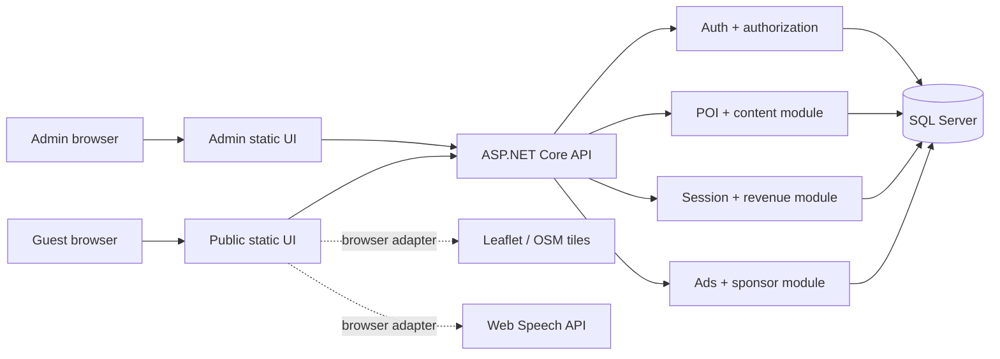
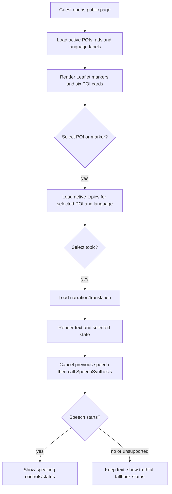
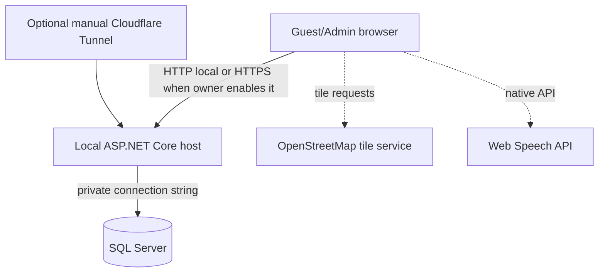

# Architecture, Components and Activity Design

> **Document ID:** DOC-ARC-001 | **Purpose:** Kiến trúc modular monolith, component, activity và deployment boundary.  
> **Version / Status:** 0.5.0 / LOCAL SQL RUNTIME VERIFIED; CONNECTION CONFIGURATION ALIGNMENT APPLIED | **Owner:** Solution Architect  
> **Last updated:** 2026-10-26 | **Related:** [Database](../03_database/DATABASE_DESIGN.md), [API](../04_api/API_SPECIFICATION.md), [Code Map](../10_development/CODE_MAP.md)

## Component diagram

### Boundaries

`wwwroot` calls relative HTTP APIs on the same ASP.NET Core origin; controllers validate input, services own rules, and EF Core persists to SQL Server. The browser never queries SQL directly or decides roles, rates, or visibility. A browser opened from file:// or another static-server origin cannot reach this relative API contract and must not be used as an application preview.

## Activity — automatic narration

For an admin content update, the authenticated API validates the DTO, the service applies the business rule in an SQL transaction, and an audit record is written before the public view reads the active data again.

## Deployment diagram

SQL Server is never exposed by Cloudflare. The tunnel is not created by code and is out of scope until manual operating approval.

The SQL Server container boundary is now verified at `127.0.0.1:14333` with loopback-only exposure, a VIVOICE-named volume and a successful container-local authenticated connection. The ASP.NET Core application-to-SQL boundary remains unverified because no application connection string, migration or application start has been approved.

## Runtime and design-time configuration boundary

Runtime obtains the `Vivoice` connection string from the standard ASP.NET Core configuration pipeline. The design-time factory now mirrors the relevant private sources: `appsettings.json`, the optional environment-specific JSON file, User Secrets only in Development, then environment variables with highest precedence. The host environment key `ConnectionStrings__Vivoice` is therefore supported without placing credentials in source code.

Docker `.env` has one purpose only: the SQL Server container password. It is not an application configuration provider and must not be reused as the web host connection-string source. Design-time work must fail explicitly when `ConnectionStrings:Vivoice` is absent; it must never silently fall back to LocalDB or another database.
