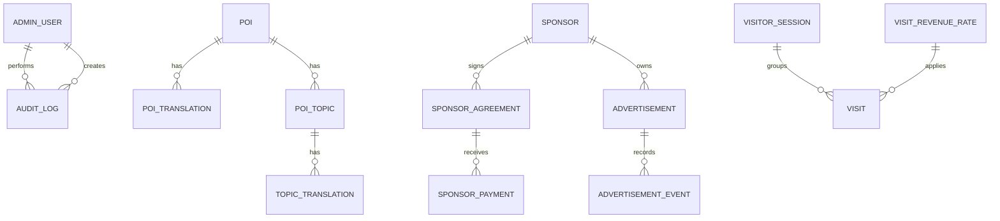

# SQL Server Database Design

> **Document ID:** DOC-DATA-001 | **Purpose:** Logical schema, ERD, data dictionary, migration and seed policy.  
> **Version / Status:** 0.3.0 / TWO MIGRATIONS GENERATED — SQL RUNTIME NOT VERIFIED | **Owner:** Database Engineer  
> **Last updated:** 2026-10-26 | **Related:** [Architecture](../02_architecture/ARCHITECTURE.md), [API](../04_api/API_SPECIFICATION.md), [Local Setup](../09_operations/LOCAL_SETUP.md)

## ERD

## Core tables

| Table | Key fields / constraints | Purpose |
|---|---|---|
| `AdminUsers` | `Id`, normalized `DisplayName`, normalized `Phone` unique, `PasswordHash`, `IsActive` | One or more admin principals; never expose hash. |
| `Pois` | `Id`, unique `Slug`, coordinates, `DisplayOrder`, `IsActive` | Map/card master data. |
| `PoiTranslations` | `(PoiId, LanguageCode)` unique, name/summary | Localized POI labels. |
| `PoiTopics` | `PoiId`, category `culture|food|tourism`, `DisplayOrder`, `IsActive` | Topic grouping. |
| `TopicTranslations` | `(TopicId, LanguageCode)` unique, title/content, `IsPublished` | Narration text actually displayed/TTS-read. |
| `Advertisements` | placement `LEFT|RIGHT`, image/target URL, schedule, `IsActive`, optional SponsorId | Sidebar creatives. |
| `AdvertisementEvents` | AdvertisementId, impression/click, UTC event time, optional session hash | Performance signal, not a financial source of truth. |
| `Sponsors`, `SponsorshipAgreements`, `SponsorshipPayments` | values in `decimal(18,2)`, date/status | Contracted, received and outstanding money separated. |
| `VisitorSessions` | anonymous random ID hash, device type, browser family, OS category, first/last seen | Privacy-minimal active-device tracking; active state is calculated from last seen. |
| `Visits` | session, occurred time, applied `RevenueRateId`, accepted/reason | Valid visit history and estimate. |
| `VisitRevenueRates` | amount, currency, effective start/end, no overlap | Historical rate, default USD 0.10. |
| `AuditLogs` | admin, action, entity, timestamp, safe details | Admin/security trace. |

## Data integrity and direct SQL policy

Use EF Core migrations; do not edit an applied migration. `Pois.IsActive`, `PoiTopics.IsActive` and `Advertisements.IsActive` are soft visibility, not destructive delete. Direct SQL edits are allowed only for non-secret content/master records through an approved operator; never manually insert `Visits`, hashes, audit rows or rate application values. The public/admin API reloads SQL data on each request; no hidden frontend fixture is permitted.

## Seed and migration policy

The migrations InitialCreate and AddOperationsManagement have been generated from VivoiceDbContext; neither has been applied because no SQL Server instance was verified during audit. The second migration adds advertisement events and browser/OS metadata for anonymous sessions. The runtime seed creates an effective 0.10 USD rate and six Vietnamese POIs/topics. It does not claim non-Vietnamese content is professionally translated. Do not seed a real admin credential. Bootstrap admin comes from User Secrets/environment and is hashed on first startup. Before every schema change: backup database, update this document/ERD/API, create migration, review generated SQL, apply to a non-production DB and record the outcome.

## Audit integrity notes

The current model separates traffic estimate, contracted value and received payments, but it has not been tested against a real database. Direct SQL must not be used to fabricate visits or advertisement events. Before operational use, enforce payment-versus-contract rules and verify that every business write and its audit record are committed transactionally; these are open findings in [Implementation Audit](../11_reports/IMPLEMENTATION_AUDIT_2026-10-26.md).
