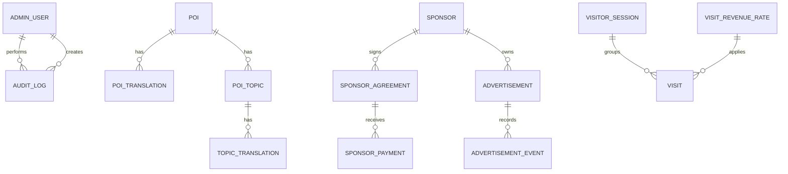

# SQL Server Database Design

> **Document ID:** DOC-DATA-001 | **Purpose:** Logical schema, ERD, data dictionary, migration and seed policy.  
> **Version / Status:** 0.5.0 / ISOLATED SQL INTEGRATION VERIFIED; FIVE-LANGUAGE BASELINE IMPLEMENTED | **Owner:** Database Engineer
> **Last updated:** 2026-10-28 | **Related:** [Architecture](../02_architecture/ARCHITECTURE.md), [API](../04_api/API_SPECIFICATION.md), [Local Setup](../09_operations/LOCAL_SETUP.md)

## ERD

## Core tables

| Table | Key fields / constraints | Purpose |
|---|---|---|
| `AdminUsers` | `Id`, normalized `DisplayName`, normalized `Phone` unique, `PasswordHash`, `IsActive` | One or more admin principals; never expose hash. |
| `Pois` | `Id`, unique `Slug`, coordinates, `DisplayOrder`, `IsActive` | Map/card master data. |
| `PoiTranslations` | `(PoiId, LanguageCode)` unique, name/summary | Localized POI labels. |
| `PoiTopics` | `PoiId`, category `culture|food|tourism`, `DisplayOrder`, `IsActive` | Topic grouping; Admin API enforces one category per POI without changing the existing schema. |
| `TopicTranslations` | `(TopicId, LanguageCode)` unique, title/content, `IsPublished` | Narration text actually displayed/TTS-read. |
| `Advertisements` | placement `LEFT|RIGHT`, image/target URL, schedule, `IsActive`, optional SponsorId | Sidebar creatives. |
| `AdvertisementEvents` | AdvertisementId, impression/click, UTC event time, optional session hash | Performance signal, not a financial source of truth. |
| `Sponsors`, `SponsorshipAgreements`, `SponsorshipPayments` | values in `decimal(18,2)`, date/status | Contracted, received and outstanding money separated. |
| `VisitorSessions` | anonymous random ID hash, device type, browser family, OS category, first/last seen | Privacy-minimal active-device tracking; active state is calculated from last seen. |
| `Visits` | session, occurred time, applied `RevenueRateId`, accepted/reason | Valid visit history and estimate. |
| `VisitRevenueRates` | amount, currency, effective start/end, no overlap | Historical rate, default USD 0.10. |
| `AuditLogs` | admin, action, entity, timestamp, safe details | Admin/security trace. |

## Data integrity and direct SQL policy

Use EF Core migrations; do not edit an applied migration. `Pois.IsActive`, `PoiTopics.IsActive` and `Advertisements.IsActive` are soft visibility, not destructive delete. Direct SQL edits are allowed only for non-secret content/master records through an approved operator; never manually insert `Visits`, hashes, audit rows or rate application values. The public/admin API reloads SQL data on each request; no hidden frontend fixture is permitted.

## Seed and migration policy

`InitialCreate` and `AddOperationsManagement` were applied successfully to the disposable, isolated database used for integration verification. The existing VIVOICE database, container and volume were not reset or changed by this work. The controlled initializer produced two migration-history rows, six POIs, 30 POI translations, 18 topics, 90 topic translations, one revenue rate and one bootstrap Admin in that isolated database.

The controlled runtime seed creates an effective 0.10 USD rate and six baseline POIs with three topics each. Translation coverage is 30 POI translation records and 90 topic translation records: Vietnamese plus Korean, Japanese, Simplified Chinese and Thai. The 96 non-Vietnamese records are editorial draft translations requiring qualified human review before a production claim.

The seed is add-only: it identifies baseline POIs by stable slug and baseline topics by category, inserts missing baseline POIs, topic categories and language records, and never updates existing POI fields, topic fields, translations, rates or Admin users. A topic that already exists (including an inactive or Admin-edited topic) is preserved exactly as it is; only an absent baseline category is inserted. A rerun against the isolated database preserved an intentionally changed Korean summary and left the verified record counts unchanged; a separately removed isolated baseline topic was restored from 17 to 18 topics and 90 topic translations by the explicit initializer. It must not mark a Vietnamese fallback as a translated record and must not run at normal web startup. Do not seed a real admin credential. Bootstrap admin comes from User Secrets/environment and is hashed only through the explicit initializer. Before every schema change or mutation of an existing database: create and verify a restorable backup, update this document/ERD/API, create migration, review generated SQL, apply to a non-production DB and record the outcome.

## Audit integrity notes

The model separates traffic estimate, contracted value and received payments. Isolated SQL verification proved only initialization, seed idempotency and protected request flows; it does not certify financial accounting. Direct SQL must not be used to fabricate visits or advertisement events. A heartbeat must use a server-issued, protected session cookie rather than an arbitrary browser UUID before it can create a visit. Initializer concurrency and complete audit-write atomicity remain operational risks requiring dedicated integration tests before financial production use.
