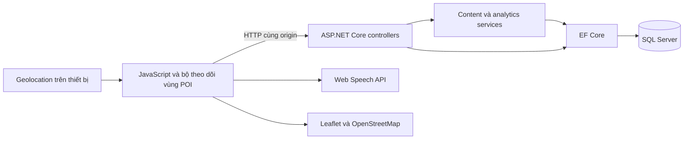
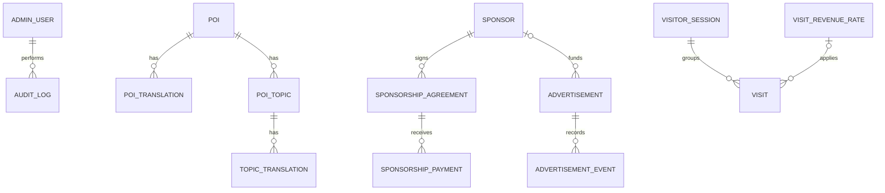

# PRD VIVOICE

Cập nhật ngày 01/11/2026. Tài liệu thống nhất dành cho sinh viên, người phát triển, kiểm thử và quản trị VIVOICE, bao quát yêu cầu sản phẩm, thiết kế kỹ thuật, triển khai, kiểm thử và vận hành. Cơ chế thuyết minh hiện hành dùng định vị GPS: khách đi vào bán kính POI sẽ được tự động phát nội dung; admin cấu hình bán kính lớn hơn 0 mét.

Các nội dung có liên hệ đã được gộp vào cùng PRD. Liên kết dưới đây dẫn thẳng đến phần liên quan. Bằng chứng đã chạy được phân biệt với kiểm thử mô phỏng và hạng mục chưa nghiệm thu.

## Mục lục

- [Phần I Yêu cầu sản phẩm và trải nghiệm](#san-pham)
- [Phần II Thiết kế kỹ thuật và dữ liệu](#thiet-ke-ky-thuat)
- [Phần III Phát triển kiểm thử và vận hành](#phat-trien)
- [Cấu hình và khởi tạo database](#2-cau-hinh-va-khoi-tao-database)
- [Ma trận kiểm thử và truy vết](#4-kiem-thu-va-truy-vet)
- [Bằng chứng lịch sử và giới hạn](#5-bang-chung-lich-su-va-gioi-han)
- [Archive tài liệu trước hợp nhất](archive/2026-10-31-before-consolidation.zip)

<a id="san-pham"></a>

## Phần I Yêu cầu sản phẩm và trải nghiệm

### 1 Mục tiêu và phạm vi

VIVOICE giới thiệu văn hóa, ẩm thực và điểm đến Việt Nam bằng tiếng Việt (`vi`), Hàn (`ko`), Nhật (`ja`), Trung (`zh`) và Anh (`en`). Khách không cần tài khoản. Khách xem bản đồ, đọc nội dung và bật định vị để tự nghe thuyết minh khi đi vào vùng của một địa điểm. Lựa chọn tiếng Thái đã lưu từ phiên bản cũ được chuyển sang tiếng Anh khi tải lại trang.

POI là điểm quan tâm trên bản đồ, có tọa độ và bán kính riêng. Nội dung địa điểm, chủ đề, bản dịch, quảng cáo và số liệu quản trị được đọc từ SQL Server qua API. Dữ liệu khởi tạo hiện có 11 địa điểm cụ thể tại Thành phố Hồ Chí Minh, mỗi địa điểm ba chủ đề: `culture`, `food`, `tourism`. Admin có thể thêm, sửa, sắp xếp và ẩn nội dung.

Admin đăng nhập bằng tên, số điện thoại và mật khẩu để quản lý POI, chủ đề, bản dịch, quảng cáo, nhà tài trợ, hợp đồng, khoản tiền nhận và đơn giá lượt truy cập. Dashboard hiển thị số liệu từ database. Phạm vi hiện tại không có quản lý tài khoản khách.

### 2 Thuyết minh tự động bằng GPS

#### 2.1 Bắt đầu và kết thúc

Khách nhấn **Bật định vị** một lần và cấp quyền trong trình duyệt. Khi có bản đo vị trí đủ chính xác nằm trong bán kính POI, hệ thống tự tải và đọc lần lượt các chủ đề công khai theo thứ tự hiển thị. Nếu lần đo đầu đã ở trong vùng thì vẫn kích hoạt một lượt.

Chọn marker, thẻ địa điểm hoặc chủ đề là thao tác xem trước văn bản. Thao tác này dừng lượt tự đọc đang chạy; không tự phát tiếng chỉ vì nhấn chọn chủ đề. Theo dõi GPS vẫn tiếp tục và lượt vào vùng kế tiếp có thể kích hoạt lại. Nút **Dừng** hủy lượt đọc và hàng đợi hiện tại; **Tạm dừng** chỉ tạm dừng giọng đang đọc. Nút **Đọc lại** dành cho nội dung đã được GPS kích hoạt khi khách vẫn trong bán kính.

Nhấn **Tắt định vị** dừng theo dõi vị trí, hủy yêu cầu nội dung đang chờ, dừng âm thanh và xóa vị trí khỏi bản đồ. Khi rời trang, ứng dụng cũng dừng theo dõi. Tính năng hoạt động trong trang đang mở; không cam kết theo dõi khi khóa màn hình, đóng trang hoặc trình duyệt đình chỉ trang chạy nền.

#### 2.2 Quy tắc vùng và phát lại

1. Bán kính tính bằng mét, phải là số hữu hạn lớn hơn 0. Bán kính bằng 0, âm, bị thiếu hoặc không phải số đều bị từ chối ở API thêm/sửa POI.
2. Biểu mẫu POI mới và migration cho dữ liệu cũ dùng bán kính mặc định **100 m**. Catalog 11 điểm TP.HCM có bán kính riêng từ 70 đến 180 m. Admin có thể thay đổi trong biểu mẫu thêm/sửa POI; seeder thông thường không ghi đè bán kính đã chỉnh.
3. Khoảng cách được tính giữa tọa độ khách và tâm POI. Khi khoảng cách không vượt bán kính, khách được coi là đi vào vùng.
4. Cập nhật GPS trong cùng một lượt ở trong vùng không khởi động lại bài đọc. Để tái kích hoạt, khách phải đi ra ngoài bán kính cộng khoảng đệm `max(10 m, 10% bán kính)` rồi đi vào lại. Khoảng đệm tránh phát lặp khi GPS dao động sát ranh giới.
5. Sai số vị trí lớn hơn bán kính của một POI không được dùng để quyết định vào hoặc ra vùng đó. Vị trí cũ quá 30 giây không được dùng để bắt đầu lượt đọc mới.
6. Nếu nhiều vùng chồng lấn, các POI vừa đi vào được xếp gần trước, xa sau. Hệ thống chỉ đọc một POI tại một thời điểm; lượt đang đọc không bị một lần vào vùng chồng lấn khác cắt ngang. POI trong hàng đợi chỉ bắt đầu nếu khách còn trong bán kính và vị trí đủ mới, đủ chính xác.
7. Khi xác nhận ra khỏi vùng theo khoảng đệm, nội dung đang đọc của POI đó dừng và yêu cầu chờ bị hủy. Phản hồi API đến muộn không được phát tiếng trở lại.
8. Đổi ngôn ngữ hủy giọng cũ, tải lại nội dung và đánh giá lại các POI gần vị trí mới nhất còn hợp lệ. Giọng đọc luôn theo ngôn ngữ thực tế của bản thuyết minh trả về.

#### 2.3 Quyền truy cập và lỗi

Định vị cần HTTPS hoặc localhost, trình duyệt hỗ trợ và sự đồng ý của khách. Ứng dụng phải hiển thị trạng thái rõ khi đang tìm vị trí, theo dõi, vị trí thiếu chính xác, bị từ chối quyền, hết thời gian chờ hoặc không có tín hiệu. Khi xảy ra lỗi định vị, khách có thể bật lại để thử lại. Bản đồ và văn bản vẫn sử dụng được khi tắt hoặc từ chối GPS.

Tọa độ khách chỉ tồn tại trong bộ nhớ trình duyệt để vẽ vị trí và tính khoảng cách. Không gửi tọa độ, sai số GPS hoặc lịch sử di chuyển đến API, analytics hoặc database.

Khả năng phát âm thanh và giọng có sẵn phụ thuộc trình duyệt, hệ điều hành và thiết bị. Chỉ hiển thị trạng thái đang đọc khi nhận được sự kiện phát thật. Nếu trình duyệt không phát được, giữ văn bản, báo trạng thái thật và cung cấp **Đọc lại** trong vùng hợp lệ; không giả báo phát thành công.

### 3 Yêu cầu và tiêu chí nghiệm thu

| Mã | Yêu cầu | Tiêu chí kiểm tra |
|---|---|---|
| FR-PUB-001 | Trang công khai, bản đồ và POI lấy từ API/SQL | Khách không đăng nhập; POI ẩn không xuất hiện. |
| FR-PUB-002 | Marker, thẻ và vùng bán kính đồng bộ | Hiển thị đúng tâm và bán kính từng POI. |
| FR-PUB-003 | Ba nhóm nội dung công khai | Chỉ hiển thị chủ đề đang hoạt động và có bản dịch đã xuất bản; có trạng thái rỗng. |
| FR-PUB-004 | Vào vùng GPS tự phát thuyết minh | Đọc các chủ đề theo thứ tự, không cần chọn chủ đề để kích hoạt. |
| FR-PUB-005 | Năm ngôn ngữ và bản dự phòng | UI và nội dung theo lựa chọn; thông báo khi dùng bản dự phòng; TTS theo `languageCode` của nội dung. |
| FR-PUB-006 | Quảng cáo theo cấu hình | Đúng thời gian và vị trí LEFT/RIGHT; thu gọn theo màn hình. |
| FR-PUB-007 | Kiểm soát lượt vào/ra | Không phát lặp trong vùng, có khoảng đệm, hủy khi ra vùng, xếp hàng khi chồng lấn. |
| FR-PUB-008 | Quyền và riêng tư GPS | Xin quyền qua thao tác bật; xử lý lỗi; không gửi vị trí khách lên máy chủ. |
| FR-ADM-001 | Đăng nhập ba trường và phân quyền | API quản trị yêu cầu vai trò admin; mật khẩu được băm. |
| FR-ADM-002 | Dashboard theo khoảng ngày | Truy cập, phiên, thiết bị, quảng cáo và từng nhóm doanh thu lấy từ SQL. |
| FR-ADM-003 | Quản lý POI, chủ đề và bản dịch | Thêm, sửa, sắp xếp và ẩn/hiện được; dữ liệu có hiệu lực ở lần đọc tiếp theo. |
| FR-ADM-004 | Quản lý quảng cáo và tài trợ | Quản lý quảng cáo, đối tác, hợp đồng, khoản nhận và lịch sử đơn giá. |
| FR-ADM-005 | Nhập và chỉnh bán kính | Biểu mẫu dùng đơn vị mét; tạo và cập nhật giữ đúng số dương; API và SQL từ chối số không dương. |
| FR-DATA-001 | Nội dung và số liệu có nguồn dữ liệu thật | Không dùng dữ liệu mẫu trên frontend để thay cho kết quả API. |
| NFR-SEC-001 | Bảo vệ dữ liệu và quản trị | Không commit secret; kiểm tra URL/đầu vào; CSRF, cookie, rate limit và audit theo thiết kế. |
| NFR-UX-001 | Giao diện dùng được trên nhiều màn hình | Có nhãn, focus, trạng thái tải/lỗi, bàn phím và responsive. |
| NFR-MAINT-001 | Mã và tài liệu truy vết được | Mỗi thay đổi nghiệp vụ có vị trí mã và bằng chứng kiểm thử trong tài liệu phát triển. |

### 4 Các tình huống sử dụng

| Mã | Người dùng và thao tác | Kết quả chính | Khi không thành công |
|---|---|---|---|
| UC-PUB-001 | Khách bật GPS và đi vào POI | Nội dung hiện lên và tự thử phát các chủ đề theo thứ tự. | Hiển thị lỗi vị trí hoặc giọng đọc; giữ nội dung có thể đọc. |
| UC-PUB-002 | Khách đổi ngôn ngữ | UI, văn bản và thuyết minh trong vùng chuyển ngôn ngữ. | Thông báo bản dự phòng hoặc nội dung chưa có. |
| UC-PUB-003 | Khách mở trang | Cookie phiên do máy chủ cấp và heartbeat ghi nhận truy cập theo quy tắc. | Lỗi analytics không chặn nội dung. |
| UC-PUB-004 | Khách chọn POI/chủ đề bằng tay | Xem trước văn bản và dừng lượt tự đọc hiện tại. | Cho phép thử lại yêu cầu nội dung. |
| UC-ADM-001 | Admin đăng nhập | Nhận cookie phiên và ghi audit. | Lỗi chung, giới hạn tần suất, không lộ tài khoản. |
| UC-ADM-002 | Admin xem hoặc lọc dashboard | Hiển thị số liệu SQL theo khoảng ngày. | Hiển thị trạng thái rỗng/lỗi, không thay bằng số mẫu. |
| UC-ADM-003 | Admin thêm/sửa POI và bán kính | Lưu tọa độ, bán kính dương, nội dung và trạng thái hiển thị. | Chặn dữ liệu không hợp lệ, giữ biểu mẫu để sửa. |
| UC-ADM-004 | Admin quản lý quảng cáo/tài trợ/đơn giá | Lưu lịch quảng cáo, hợp đồng và khoản nhận hợp lệ. | Từ chối sai URL, thời gian, đơn giá hoặc số tiền. |

### 5 Quy tắc nghiệp vụ khác

Một lượt truy cập hợp lệ được ghi ở heartbeat đầu của một phiên do máy chủ cấp, sau bước phân loại bot đơn giản. Heartbeat gửi mỗi 30 giây; thời gian hoạt động mặc định là 90 giây. Phiên là đại diện cho phiên trình duyệt, không chứng minh một con người hay thiết bị vật lý duy nhất.

Đơn giá khởi tạo là 0,10 USD cho mỗi lượt hợp lệ. Lượt cũ giữ đơn giá đã áp dụng; mức mới có thời điểm hiệu lực mới. Dashboard tách ước tính từ truy cập, giá trị hợp đồng, khoản đã nhận và khoản còn phải thu. Ước tính truy cập phục vụ demo, không phải hệ thống kế toán chống gian lận.

Hợp đồng đã hủy không nhận thêm khoản thanh toán. Tổng tiền nhận không vượt cam kết; không giảm cam kết xuống dưới số đã nhận. Dashboard hiện tổng hợp USD. Các kiểm tra đồng thời trên SQL vẫn phải được thực hiện trước khi dùng cho nghiệp vụ tài chính thực tế.

### 6 Quy tắc giao diện

Header công khai chứa thương hiệu VIVOICE và bộ chọn ngôn ngữ. Nút định vị cùng trạng thái nằm cạnh khu vực bản đồ. Bản đồ hiển thị chấm vị trí khách, vòng xanh bán kính quanh khách (mặc định 100 m, chọn 50/100/200/500 m), vòng đỏ vùng thuyết minh POI và vòng nét đứt thể hiện sai số GPS. Các vòng di chuyển theo vị trí; tắt định vị sẽ xóa chúng. Có chú giải và nút đưa bản đồ về vị trí khách. Vòng xanh là thước đo khoảng cách tham khảo; điều kiện tự phát vẫn là vị trí khách đi vào bán kính POI theo mục 2, không dùng việc hai vòng giao nhau để kích hoạt. Trang quản trị truy cập trực tiếp tại `/admin.html`, được bảo vệ bằng API đăng nhập; không đưa liên kết Admin vào điều hướng công khai.

Nhãn nhóm tiếng Việt là **Văn hóa đặc sắc**, **Ẩm thực nổi tiếng**, **Điểm du lịch nổi bật**. Giá trị dữ liệu tương ứng vẫn là `culture`, `food`, `tourism`. Quảng cáo hai rìa có nhãn tài trợ và được ẩn trên màn hình hẹp để ưu tiên bản đồ, nội dung.

| Thành phần thiết kế | Giá trị |
|---|---|
| Nền thương hiệu tối | `--color-velvet-crimson`: `#450A0A` |
| Nền sáng | `--color-champagne-silk`: `#E7D9BF` |
| Màu chữ chính | `--color-espresso-brown`: `#2C1B12` |
| Hành động chính | `--color-romance-red`: `#7A2116` |
| Điểm nhấn | `--color-gold-highlight`: `#C6A15B` |
| Phông chữ | Arial, Segoe UI, sans-serif; nội dung UTF-8 |

Màu sắc tập trung trong biến CSS. Điều khiển có nhãn, focus nhìn thấy được, hỗ trợ bàn phím và trạng thái không chỉ phân biệt bằng màu. Bố cục thu về một cột trên điện thoại, tôn trọng `prefers-reduced-motion`.

### 7 Phạm vi xác minh

Các yêu cầu trên là tiêu chí sản phẩm. Việc đã có mã hoặc kiểm thử mô phỏng không thay thế kiểm tra GPS và âm thanh trên điện thoại thật. Xem [ma trận truy vết và kết quả kiểm thử](#4-kiem-thu-va-truy-vet) để phân biệt phần đã kiểm tra, bằng chứng lịch sử và phần chưa chạy.

<a id="thiet-ke-ky-thuat"></a>

## Phần II Thiết kế kỹ thuật và dữ liệu

### 1 Kiến trúc ứng dụng

Ứng dụng dùng C# với ASP.NET Core trên .NET 9, EF Core 9.0.11 và SQL Server 2022. HTML/CSS/JavaScript thuần trong `wwwroot` được cùng web host phục vụ với API. Leaflet 1.9.4 sử dụng ảnh bản đồ OpenStreetMap; Web Speech API đọc văn bản bằng khả năng của trình duyệt. Node.js phục vụ kiểm thử JavaScript, không chạy backend sản phẩm.



Đây là modular monolith: một host, chia chức năng bằng controller, service và lớp dữ liệu. Một số API quản trị làm việc trực tiếp với DbContext. Trình duyệt gọi đường dẫn tương đối `/api/...`, không truy vấn SQL trực tiếp. Phải mở giao diện qua host ASP.NET Core, tránh mở HTML bằng `file://` hoặc một static server khác.

### 2 GPS và luồng thuyết minh

#### 2.1 Xác định vùng

`gps-guide.js` tính khoảng cách Haversine bằng mét, với bán kính Trái Đất 6.371.000 m. Mỗi POI có tọa độ và `radiusMeters` dương. Tracker giữ tập POI đã đi vào trong bộ nhớ, phát sự kiện vào một lần, và chỉ xóa trạng thái sau khi ra ngoài `radiusMeters + max(10, radiusMeters * 0.1)`.

`watchPosition` chỉ bắt đầu khi nhấn nút bật, với `enableHighAccuracy: true`, `maximumAge: 5000`, `timeout: 15000`. Vĩ độ phải trong [-90, 90], kinh độ trong [-180, 180], sai số không âm và hữu hạn. Bản đo quá 30 giây, cũ hơn bản đã nhận hoặc có thời gian vượt tương lai quá 5 giây bị bỏ qua. Sai số lớn hơn bán kính POI không được dùng để xác định vào/ra POI đó.

Một hàng đợi duy trì thứ tự các POI vừa đi vào, ưu tiên gần trước. Trước khi bắt đầu một mục, controller kiểm tra vị trí mới nhất vẫn ở trong bán kính thật và đủ chính xác. Chỉ có một mục phát tại một thời điểm. Khoảng đệm dùng cho việc xác nhận rời vùng, không mở rộng vùng bắt đầu phát.

#### 2.2 Đồng bộ nội dung và âm thanh

Khi nhận lượt vào POI, `public.js` hủy yêu cầu xem trước cũ, tải danh sách chủ đề và lấy từng bản thuyết minh theo thứ tự API trả về. Văn bản và ngôn ngữ thực tế được hiển thị trước khi gọi SpeechSynthesis. Sự kiện kết thúc giọng đọc thành công mới chuyển sang chủ đề tiếp theo. Lỗi phát giữ lại văn bản và điều khiển đọc lại trong vùng.

Mỗi lượt có `AbortController` riêng. Ra khỏi vùng, tắt GPS, đổi ngôn ngữ hoặc thao tác xem trước hủy lượt hiện tại và giọng đọc. Các kiểm tra signal/ngôn ngữ sau mỗi lần chờ ngăn phản hồi cũ phát trở lại. Callback của lượt đã hủy không được xóa trạng thái lượt mới. Sự kiện `pagehide` dừng watch và phát âm thanh.

`tts-language.js` ánh xạ `vi→vi-VN`, `ko→ko-KR`, `ja→ja-JP`, `zh→zh-CN`, `en→en-US`; chọn giọng theo locale chính xác rồi ngôn ngữ chính. Nó sử dụng `narration.languageCode`, kể cả khi backend trả bản dự phòng khác ngôn ngữ UI.

#### 2.3 Quyền và dữ liệu vị trí

Header dùng `Permissions-Policy: camera=(), geolocation=(self), microphone=()`. Geolocation hoạt động trong secure context và cần người dùng cho phép. API không nhận vị trí khách; model SQL không có lịch sử tọa độ khách. Các POST telemetry tiếp tục chỉ dùng cookie phiên và loại sự kiện quảng cáo.

Tham khảo chính thức về trình duyệt: [Geolocation watchPosition](https://developer.mozilla.org/en-US/docs/Web/API/Geolocation/watchPosition), [Permissions Policy cho geolocation](https://developer.mozilla.org/en-US/docs/Web/HTTP/Reference/Headers/Permissions-Policy/geolocation), [SpeechSynthesis speak](https://developer.mozilla.org/en-US/docs/Web/API/SpeechSynthesis/speak).

### 3 Database và quy tắc dữ liệu

#### 3.1 Các bảng chính

| Bảng | Mục đích và ràng buộc |
|---|---|
| `AdminUsers` | Tên và điện thoại chuẩn hóa có chỉ mục unique theo cặp; chỉ lưu `PasswordHash`. |
| `Pois` | Slug unique, tọa độ `decimal(9,6)`, bán kính `float` dương mặc định 100, thứ tự và trạng thái hiển thị. |
| `PoiTranslations` | Tên và mô tả theo ngôn ngữ; unique `(PoiId, LanguageCode)`. |
| `PoiTopics` | Chủ đề `culture`, `food`, `tourism`; API giới hạn một nhóm cho một POI. |
| `TopicTranslations` | Tiêu đề, nội dung thuyết minh và trạng thái xuất bản; unique theo chủ đề/ngôn ngữ. |
| `Advertisements` | Ảnh, URL đích HTTPS, vị trí LEFT/RIGHT, thời gian, thứ tự và liên kết sponsor tùy chọn. |
| `AdvertisementEvents` | Impression/click, thời gian UTC và hash phiên tùy chọn. |
| `Sponsors` | Thông tin nhà tài trợ và trạng thái hoạt động. |
| `SponsorshipAgreements` | Cam kết, trạng thái, thời hạn và tiền tệ; tiền dùng `decimal(18,2)`. |
| `SponsorshipPayments` | Khoản nhận cho hợp đồng, số tiền và thời điểm. |
| `VisitRevenueRates` | Đơn giá `decimal(18,4)` và khoảng hiệu lực; thời điểm bắt đầu unique. |
| `VisitorSessions` | Hash định danh phiên, nhóm thiết bị/trình duyệt/hệ điều hành, first/last seen. |
| `Visits` | Phiên, đơn giá đã áp dụng, tiền tệ, thời gian và tính hợp lệ. |
| `AuditLogs` | Admin, hành động, loại đối tượng, ID và thời gian. |



#### 3.2 Bán kính POI

Entity `Poi.RadiusMeters`, request thêm/sửa và DTO công khai đều dùng `double`. JSON dùng tên `radiusMeters`. `PoiRadiusPolicy` yêu cầu `double.IsFinite(value) && value > 0`. Trường thiếu sẽ thành 0 và bị từ chối. Biểu mẫu admin kiểm tra trước khi gửi và hiển thị lỗi bằng tiếng Việt. Ràng buộc SQL `CK_Pois_RadiusMeters_Positive` yêu cầu `[RadiusMeters] > 0`.

Migration `20261031053239_AddPoiGeofenceRadius` bổ sung cột `float NOT NULL DEFAULT 100` và check constraint. Nó giữ nguyên POI/bản dịch hiện có; giá trị 100 m bổ sung cho các hàng cũ. Không sửa hai migration đã có: `InitialCreate`, `AddOperationsManagement`. `VivoiceDbContextModelSnapshot.cs` phản ánh model mới. `migration-review.sql` chứa SQL để xem xét; [quy trình áp dụng migration](#2-cau-hinh-va-khoi-tao-database) yêu cầu xác định đúng database và backup trước khi cập nhật dữ liệu hiện có.

#### 3.3 Seed và tính toàn vẹn

Baseline hiện có 11 POI, 55 bản dịch POI, 33 chủ đề và 165 bản dịch chủ đề; 176 bản dịch không phải tiếng Việt còn cần rà soát biên tập trước sử dụng thực tế. Nội dung nằm trong `Data/BaselineContent.json`, gồm tọa độ, bán kính, nguồn tham khảo và các bài thuyết minh theo từng địa điểm. Seeder chỉ thêm phần còn thiếu theo slug POI và nhóm chủ đề, giữ nguyên nội dung, trạng thái, tọa độ và bán kính đã tồn tại. Đơn giá khởi tạo là 0,10 USD khi bảng đơn giá chưa có dữ liệu. Thay toàn bộ bộ POI chỉ diễn ra qua công cụ demo riêng được gọi rõ ràng với `-ReplaceExisting`.

POI, chủ đề và quảng cáo dùng cờ ẩn/hiện. Chỉ nội dung đang hoạt động, bản dịch đã xuất bản và quảng cáo đúng lịch được trả cho public. Backend ưu tiên ngôn ngữ yêu cầu, tiếp đến tiếng Việt, cuối cùng một bản đang có; response có cờ `fallbackUsed` và ngôn ngữ thực tế cho thuyết minh.

Cập nhật cam kết hợp đồng và thêm khoản nhận dùng transaction `Serializable`. API từ chối trả vượt cam kết, thanh toán vào hợp đồng hủy và giảm cam kết xuống dưới khoản đã nhận. Những luồng quản trị khác chưa bảo đảm mọi lần ghi nội dung và audit đều thuộc một transaction chung. Xem [giới hạn kiểm chứng](#5-bang-chung-lich-su-va-gioi-han) trước khi suy rộng sang nghiệp vụ tài chính thực tế.

#### 3.4 Khóa ngoại và chặn xóa dữ liệu đang được tham chiếu

Mọi khóa ngoại dùng `ON DELETE NO ACTION` và `ON UPDATE NO ACTION`. Khi còn bản ghi con tham chiếu, SQL Server từ chối xóa bản ghi cha; cũng từ chối thêm/sửa khóa ngoại trỏ tới ID không tồn tại. Ràng buộc có hiệu lực cả khi ứng dụng ghi dữ liệu lẫn khi chạy SQL trực tiếp. Không tự xóa dây chuyền hoặc tự đặt khóa ngoại thành `NULL` khi xóa bản ghi cha.

| Bản ghi cha được bảo vệ | Bảng đang tham chiếu |
|---|---|
| `Pois` | `PoiTranslations`, `PoiTopics` |
| `PoiTopics` | `TopicTranslations` |
| `Sponsors` | `Advertisements`, `SponsorshipAgreements` |
| `Advertisements` | `AdvertisementEvents` |
| `SponsorshipAgreements` | `SponsorshipPayments` |
| `VisitorSessions` | `Visits` |
| `VisitRevenueRates` | `Visits` |
| `AdminUsers` | `AuditLogs` |

EF Core cấu hình toàn bộ quan hệ bằng `DeleteBehavior.ClientNoAction` để giữ nguyên dữ liệu con và khóa ngoại ngay cả khi các đối tượng đã được tải vào bộ nhớ. Chỉ dùng `NoAction`/`Restrict` ở EF có thể vẫn tự đặt khóa ngoại tùy chọn thành rỗng; lựa chọn hiện tại tránh hành vi đó. Tham khảo [DeleteBehavior của EF Core](https://learn.microsoft.com/en-us/dotnet/api/microsoft.entityframeworkcore.deletebehavior?view=efcore-9.0).

Ví dụ: POI có bản dịch/chủ đề sẽ không xóa được; nhà tài trợ có quảng cáo/hợp đồng và hợp đồng có khoản nhận cũng không xóa được. Dùng `IsActive=false` để ẩn/ngừng hoạt động ở các đối tượng có cờ này, giữ lịch sử liên quan. Bản ghi không còn được tham chiếu có thể xóa; công cụ thay catalog demo chỉ xóa có chủ đích từ bảng con lên bảng cha sau backup, không tắt ràng buộc. API quản trị hiện cung cấp thao tác thêm/sửa/ẩn, chưa có endpoint xóa cứng. Lỗi SQL 547 khi lưu/xóa qua EF được phản hồi HTTP 409 với mã `DATA_INTEGRITY_CONFLICT` và thông báo tiếng Việt, không trả chi tiết SQL nội bộ.

Migration `20261102042637_RestrictReferencedDeletes` đổi 9 khóa ngoại trước đây xóa dây chuyền/đặt rỗng sang `NO ACTION`; quan hệ `Visits.VisitRevenueRateId` đã có `NO ACTION` ở SQL. Tổng cộng 10 khóa ngoại đều được bật và kiểm tra dữ liệu hiện có. Migration chỉ đổi ràng buộc, giữ nguyên bảng, cột, ID và nội dung. Các migration lịch sử giữ nguyên; [SQL review](../src/Vivoice.Web/migration-review.sql) tạo đầy đủ chuỗi migration nên các lệnh cascade trong phần lịch sử được thay bằng ràng buộc mới ở cuối script.

### 4 Hợp đồng API

JSON sử dụng UTF-8, thời gian UTC ISO-8601. Lỗi nghiệp vụ có `code` và `message`; không trả stack trace, secret hoặc hash mật khẩu. Public nhận DTO; backend quyết định quyền, nội dung hiển thị và đơn giá.

#### 4.1 API công khai

| Phương thức và đường dẫn | Chức năng |
|---|---|
| `GET /api/public/pois?lang=vi` | POI hoạt động, tọa độ, `radiusMeters`, tên/mô tả và fallback. |
| `GET /api/public/pois/{id}/topics?lang=vi` | Chủ đề hoạt động, có bản dịch xuất bản, sắp theo thứ tự. |
| `GET /api/public/topics/{id}/narration?lang=vi` | Tiêu đề, văn bản, category, ngôn ngữ thực tế và fallback. |
| `GET /api/public/advertisements?placement=LEFT` | Quảng cáo còn hiệu lực tại LEFT hoặc RIGHT. |
| `POST /api/public/sessions` | Cấp cookie phiên được Data Protection bảo vệ; chưa tạo lượt truy cập. |
| `POST /api/public/sessions/heartbeat` | Dùng cookie hợp lệ, cập nhật last-seen và có thể ghi lượt đầu. |
| `POST /api/public/advertisements/{id}/events` | Nhận `eventType` là impression hoặc click; dùng cookie phiên khi có. |

GPS không tạo endpoint vị trí mới. Frontend đọc tâm và bán kính POI rồi tự đánh giá trên thiết bị.

#### 4.2 API quản trị

| Phương thức và đường dẫn | Chức năng |
|---|---|
| `GET /api/admin/auth/antiforgery` | Cấp request token chống CSRF, trả `{ token }`. |
| `POST /api/admin/auth/login` | Đăng nhập bằng `displayName`, `phone`, `password`. |
| `POST /api/admin/auth/logout`, `GET /api/admin/auth/me` | Kết thúc hoặc kiểm tra phiên quản trị. |
| `GET /api/admin/dashboard?from=...&to=...` | Thống kê theo thời gian. |
| `GET /api/admin/devices/active` | Thông tin nhóm thiết bị của các phiên hoạt động. |
| `GET/POST /api/admin/pois`, `PATCH /api/admin/pois/{id}` | Danh sách, thêm và sửa POI, gồm bán kính. |
| `GET/POST /api/admin/pois/{id}/topics`, `PATCH /api/admin/topics/{id}` | Quản lý chủ đề. |
| `GET /api/admin/pois/{id}/translations`, `PUT .../translations/{languageCode}` | Đọc và thêm/sửa bản dịch POI. |
| `GET /api/admin/topics/{id}/translations`, `PUT .../translations/{languageCode}` | Đọc và thêm/sửa bản dịch chủ đề. |
| `GET/POST /api/admin/advertisements`, `PATCH /api/admin/advertisements/{id}` | Quảng cáo. |
| `GET/POST /api/admin/sponsors`, `PATCH /api/admin/sponsors/{id}` | Nhà tài trợ. |
| `GET/POST /api/admin/sponsorship-agreements`, `PATCH /api/admin/sponsorship-agreements/{id}` | Hợp đồng tài trợ. |
| `POST /api/admin/sponsorship-agreements/{id}/payments` | Ghi nhận khoản nhận. |
| `GET/POST /api/admin/revenue-rates` | Xem và thêm mức đơn giá có hiệu lực mới. |

Request thêm/sửa POI:

```json
{
  "slug": "diem-tham-quan",
  "latitude": 21.028511,
  "longitude": 105.804817,
  "radiusMeters": 100,
  "imageUrl": null,
  "displayOrder": 1,
  "isActive": true,
  "nameVi": "Điểm tham quan",
  "summaryVi": "Giới thiệu địa điểm"
}
```

Bán kính không hợp lệ trả HTTP 400 với `code: INVALID_RADIUS`. Các mã khác thường gặp: 400 đầu vào/CSRF/phiên không hợp lệ; 401 chưa đăng nhập; 403 thiếu vai trò; 404 không tìm thấy; 409 trùng slug/nhóm, sai thứ tự đơn giá hoặc xung đột cam kết; 429 vượt tần suất.

### 5 Bảo mật và cấu hình

Admin dùng cookie `vivoice_admin`, HttpOnly, SameSite Strict, Secure theo giao thức request sau xử lý proxy tin cậy. Mật khẩu được ASP.NET Core `PasswordHasher` băm. Cookie phiên khách `vivoice_visitor` chứa định danh được Data Protection bảo vệ; server lưu hash định danh. `localStorage` chỉ giữ lựa chọn ngôn ngữ của public, không giữ mật khẩu hay token admin dài hạn.

Các yêu cầu quản trị thay đổi trạng thái, kể cả login/logout, phải gửi token qua `X-VIVOICE-CSRF`. Backend giới hạn nhóm login 5 yêu cầu/phút/IP và telemetry 60 yêu cầu/phút/IP. Đây là bộ đếm trong tiến trình; không chứng minh khả năng chống lạm dụng phân tán hoặc đếm người dùng duy nhất.

Chỉ tin forwarded headers từ proxy loopback, giới hạn một bước. Header bảo vệ gồm CSP, nosniff, chống frame, referrer policy và HSTS cho HTTPS. Chỉ cho URL ảnh và đích quảng cáo HTTPS. Frontend dùng `textContent` cho văn bản dữ liệu. SQL dùng EF Core, kiểm tra đầu vào và giới hạn trường request.

Connection string và bootstrap admin được lấy từ cấu hình riêng: JSON chung, JSON môi trường, User Secrets trong Development, rồi biến môi trường. `ConnectionStrings__Vivoice` tương ứng `ConnectionStrings:Vivoice`. Docker `.env` chỉ phục vụ mật khẩu SQL Server container. `Authentication:CookieSecret` không phải cấu hình của ứng dụng.

Normal startup không tự migration/seed/tạo admin. Lệnh initializer riêng chạy migration, seed và bootstrap tùy chọn, xong thì thoát. `/health` báo tiến trình còn sống; `/ready` chỉ thành công khi kết nối được database và không còn migration chờ. Production còn cần thiết kế key ring Data Protection bền vững và quyền SQL của web không có DDL.

### 6 Bản đồ mã nguồn và quyết định

| Khu vực | File hoặc thư mục chính |
|---|---|
| Startup, headers, DI, readiness | [Program.cs](../src/Vivoice.Web/Program.cs), `Services/DatabaseReadinessService.cs` |
| GPS, khoảng cách, hàng đợi, hủy lượt | [gps-guide.js](../src/Vivoice.Web/wwwroot/gps-guide.js) |
| Giao diện public và điều phối TTS | [public.js](../src/Vivoice.Web/wwwroot/public.js), `wwwroot/index.html`, `wwwroot/site.css` |
| Chọn locale/voice | [tts-language.js](../src/Vivoice.Web/wwwroot/tts-language.js) |
| Biểu mẫu POI và bán kính | [admin.html](../src/Vivoice.Web/wwwroot/admin.html), [admin.js](../src/Vivoice.Web/wwwroot/admin.js) |
| API, kiểm tra bán kính và audit | [AdminController.cs](../src/Vivoice.Web/Controllers/AdminController.cs), `Controllers/PublicController.cs`, `Controllers/AdminAuthController.cs` |
| DTO | [Contracts.cs](../src/Vivoice.Web/Models/Contracts.cs) |
| Schema và entities | [VivoiceDbContext.cs](../src/Vivoice.Web/Data/VivoiceDbContext.cs), `Data/Entities/` |
| Migration | [Data/Migrations](../src/Vivoice.Web/Data/Migrations), [migration-review.sql](../src/Vivoice.Web/migration-review.sql) |
| Nội dung, seed, initializer | `Services/PublicContentService.cs`, `Data/BaselineContent.cs`, [BaselineContent.json](../src/Vivoice.Web/Data/BaselineContent.json), `Data/DatabaseSeeder.cs`, `Services/DatabaseInitialization.cs` |
| Phiên và thống kê | `Services/VisitorSessionCookieService.cs`, `Services/AnalyticsService.cs`, `wwwroot/visitor-session.js` |
| Kiểm thử và CI | [tests](../tests/Vivoice.Web.Tests), [.github/workflows/ci.yml](../.github/workflows/ci.yml) |

ADR-001 giữ một ASP.NET Core host cho public/admin/API. ADR-002 dùng EF Core SQL Server. ADR-003 dùng Web Speech API; từ bản cập nhật này trigger chuyển sang GPS. ADR-004 dùng Leaflet/OpenStreetMap cho local/demo, cần kiểm tra chính sách nhà cung cấp trước triển khai công khai quy mô lớn. ADR-005 giữ định nghĩa lượt đầu của phiên và TTL như PRD. ADR-006 dùng `zh` cho dữ liệu và ưu tiên voice `zh-CN`.

ADR-007 bổ sung bán kính POI và bộ phát theo sự kiện vào vùng, không lưu vị trí khách. ADR-008 hợp nhất toàn bộ tài liệu hiện hành thành một PRD, với các phần sản phẩm, thiết kế kỹ thuật và phát triển/vận hành. [Archive](archive/2026-10-31-before-consolidation.zip) giữ nguyên các bản Markdown/Word trước hợp nhất để tra cứu lịch sử; chúng không còn là bộ yêu cầu hiện hành.

<a id="phat-trien"></a>

## Phần III Phát triển kiểm thử và vận hành

### 1 Môi trường và cấu trúc

Cần .NET SDK hỗ trợ `net9.0`, SQL Server 2022 hoặc instance SQL Server phù hợp, Node.js để kiểm thử frontend, trình duyệt hỗ trợ Geolocation/Web Speech API. CI dùng .NET 9 và Node.js 22. Khi quản lý migration, dùng `dotnet-ef` cùng dòng phiên bản EF Core 9.0.11. Docker Desktop phục vụ SQL local; Cloudflare Tunnel chỉ cần khi chia sẻ demo HTTPS.

| Thư mục | Trách nhiệm |
|---|---|
| `src/Vivoice.Web` | Web host, API, service, dữ liệu và giao diện. |
| `tests/Vivoice.Web.Tests/Unit` | Kiểm thử quy tắc C# và đầu vào controller. |
| `tests/Vivoice.Web.Tests/Frontend` | Kiểm thử JS, GPS mô phỏng, DOM/API/giọng đọc giả lập và biểu mẫu admin. |
| `.github/workflows` | CI build, C# tests, cú pháp JS và Node tests. |
| `tools` | Script demo và công cụ kiểm tra ảnh tài liệu. |
| `docs` | Một PRD thống nhất và archive lịch sử. |

`src/TourGuide.Api` và `tests/TourGuide.Tests` chỉ còn file build `bin/obj`, không phải module có mã nguồn đang phát triển. `bin/obj` là sản phẩm build được Git bỏ qua.

<a id="2-cau-hinh-va-khoi-tao-database"></a>

### 2 Cấu hình và khởi tạo database

#### 2.1 Cấu hình riêng

Chọn đúng instance/database phát triển. Compose hiện có ánh xạ SQL `127.0.0.1:14333` tới cổng container 1433. Connection string đặt trong User Secrets của `src/Vivoice.Web` hoặc biến môi trường `ConnectionStrings__Vivoice`. Các khóa admin đầu tiên là `BootstrapAdmin:DisplayName`, `BootstrapAdmin:Phone`, `BootstrapAdmin:Password`; thay dấu `:` bằng `__` khi dùng biến môi trường.

Nếu dùng User Secrets, chọn Development trong PowerShell:

```powershell
$env:ASPNETCORE_ENVIRONMENT = 'Development'
```

Không đưa giá trị bí mật vào source, log, ảnh chụp hoặc lịch sử lệnh. `.env` chỉ cung cấp `MSSQL_SA_PASSWORD` cho Compose, không tự cấp connection string cho ASP.NET Core. Không có LocalDB fallback. `Authentication:CookieSecret` không được ứng dụng sử dụng.

Để chạy demo trong PowerShell, khối sau chủ động đọc mật khẩu từ `.env` và cấu hình database riêng `VivoiceDemo`. Thực hiện từ thư mục gốc, giữ cùng terminal khi khởi tạo và chạy web. Biến môi trường có hiệu lực trong phiên này và các tiến trình con, không tự lưu sang terminal khác.

```powershell
$demoSqlLine = Get-Content .env | Where-Object { $_ -match '^\s*MSSQL_SA_PASSWORD\s*=' } | Select-Object -Last 1
if (-not $demoSqlLine) { throw 'Thieu MSSQL_SA_PASSWORD trong .env' }
$demoSqlPassword = ($demoSqlLine -split '=', 2)[1].Trim().Trim("'", '"')
$demoConnection = [System.Data.Common.DbConnectionStringBuilder]::new()
$demoConnection.set_ConnectionString('Server=127.0.0.1,14333;Database=VivoiceDemo;User ID=sa;TrustServerCertificate=True')
$demoConnection['Password'] = $demoSqlPassword
$env:ConnectionStrings__Vivoice = $demoConnection.get_ConnectionString()
$env:ASPNETCORE_ENVIRONMENT = 'Development'
$env:BootstrapAdmin__DisplayName = 'DemoAdmin'
$env:BootstrapAdmin__Phone = '0900000000'
if (-not $env:BootstrapAdmin__Password) {
    $env:BootstrapAdmin__Password = [Net.NetworkCredential]::new('', (Read-Host 'Nhap mat khau admin moi' -AsSecureString)).Password
}
```

Với connection-string builder trong PowerShell, dùng rõ `set_ConnectionString(...)` và `get_ConnectionString()`. Cách gán/đọc `.ConnectionString` qua dấu chấm có thể bị lớp adapter cho dictionary xử lý như một key, làm chuỗi được xuất ra thiếu mật khẩu vừa thêm. Lỗi này đã được tái hiện bằng dữ liệu kiểm thử và khối đã sửa đã kết nối SQL thành công. Ví dụ trên hỗ trợ định dạng một dòng `MSSQL_SA_PASSWORD='gia-tri'` hiện dùng trong repo; không in giá trị ra terminal.

#### 2.2 Docker SQL Server

Compose dùng SQL Server 2022 Developer cố định theo digest, container `vivoice-sqlserver-dev`, volume `vivoice_sqlserver_data`, bind loopback 14333 và healthcheck dựa trên error log. Cần mật khẩu riêng trong `.env`. Với môi trường đã xác định và cấu hình xong:

```powershell
docker compose up -d sqlserver
docker compose ps
```

Lệnh có thể tải image, tạo container/volume và dùng tài nguyên máy. Kiểm tra tên và cổng thuộc VIVOICE, giữ nguyên tài nguyên dự án khác. Dữ liệu nằm trong named volume; không xóa volume hoặc reset database để thử lại migration. SQL Developer dành cho phát triển/kiểm thử; kiểm tra điều kiện cấp phép khi chọn môi trường khác.

#### 2.3 Migration và initializer

Có ba migration: `InitialCreate`, `AddOperationsManagement`, `AddPoiGeofenceRadius`. Migration mới thêm bán kính 100 m cho POI cũ và constraint bán kính dương. Source migration và SQL review đã tạo; chưa áp dụng lên database hiện có trong lượt cập nhật ngày 31/10/2026.

Ngày 01/11/2026, cả ba migration cùng dữ liệu baseline đã được áp dụng thành công trên database demo mới `VivoiceDemo`; xem kết quả runtime bên dưới. Bootstrap admin vẫn cần mật khẩu do người dùng chọn trong terminal.

Ngày 02/11/2026 bổ sung migration thứ tư `RestrictReferencedDeletes` để chặn xóa bản ghi đang được tham chiếu. Migration đã được thử trên bản sao khôi phục từ backup, sau đó áp dụng vào `VivoiceDemo` với dữ liệu được giữ nguyên; quy tắc hiện hành ở mục 3.4 phần thiết kế database.

Trước khi cập nhật database có dữ liệu, xác định đúng instance/database, tạo và kiểm tra backup có thể khôi phục, đọc [SQL review](../src/Vivoice.Web/migration-review.sql), rồi thử trên database tách biệt. Không sửa migration đã áp dụng hoặc chạy initializer đồng thời.

Với database phát triển đã chọn và đáp ứng bước backup cần thiết:

```powershell
dotnet run --project src/Vivoice.Web -- --initialize-database
```

Lệnh chạy migration rồi seed và thoát, không mở web hoặc tự tạo admin. Chỉ khi cần admin đầu tiên và đã cấu hình đủ ba khóa riêng:

```powershell
dotnet run --project src/Vivoice.Web -- --initialize-database --bootstrap-admin
```

Admin đã có được giữ nguyên. Seeder chỉ thêm phần thiếu, không ghi đè POI, bán kính, chủ đề, bản dịch hoặc đơn giá. Các giai đoạn migration/seed/bootstrap có kết quả bền vững riêng; seed có transaction riêng, lỗi seed không hoàn tác migration đã thành công. Normal startup không tự thay schema hoặc seed.

Tạo migration/SQL và so model cần cấu hình design-time nhưng không cần kết nối SQL. Sau build Release, có thể kiểm tra:

```powershell
dotnet ef migrations has-pending-model-changes --project src/Vivoice.Web --configuration Release --no-build
```

EF CLI 9.0.0 hiện có trên máy báo cũ hơn runtime 9.0.11; đây là cảnh báo công cụ, không phải kết quả kiểm chứng SQL.

### 3 Chạy ứng dụng và kiểm tra GPS

Sau khi database sẵn sàng:

```powershell
dotnet run --project src/Vivoice.Web -- --urls http://127.0.0.1:5078
```

Mở trang gốc và `/admin.html` qua host. `/health` báo tiến trình; `/ready` trả 200 khi SQL kết nối được và không còn migration chờ, nếu chưa sẵn sàng trả 503. Chỉ `/health` thành công chưa chứng minh SQL hoạt động.

#### 3.1 GPS trên trình duyệt

Localhost/loopback dùng cho phát triển. Điện thoại truy cập máy khác cần HTTPS; HTTP qua IP LAN không phải môi trường nghiệm thu định vị. Khách nhấn **Bật định vị**, cấp quyền và giữ trang mở. Geolocation có thể dùng GPS hoặc nguồn vị trí khác của thiết bị; ứng dụng dùng tọa độ và sai số trình duyệt cung cấp.

Admin chọn tọa độ POI gần nơi thử và bán kính dương phù hợp. Mười POI baseline nằm tại các điểm tham quan ở TP.HCM; ví dụ Dinh Độc Lập có tâm `10.776940, 106.695280` và bán kính 180 m. Có thể dùng vị trí mô phỏng trong công cụ trình duyệt để thử tại bàn, nhưng phải phân biệt với GPS thật. Bản đồ tự căn theo tập POI trả về ở lần tải đầu; đổi ngôn ngữ giữ góc nhìn hiện tại.

Kịch bản nghiệm thu thủ công:

1. Thêm/sửa bán kính, tải lại admin kiểm tra lưu bền. Nhập 0, số âm hoặc trống bị chặn; gửi trực tiếp API tương tự trả 400.
2. Chưa bật hoặc từ chối GPS vẫn xem bản đồ/văn bản. Chọn POI/chủ đề không tự phát giọng.
3. Bật GPS ngoài vùng: chưa phát. Vào vùng: tự đọc lần lượt chủ đề. Ở trong vùng: không lặp từ đầu.
4. Dao động sát ranh giới không lặp. Ra ngoài cả khoảng đệm thì dừng, vào lại có lượt mới.
5. Hai vùng chồng lấn: gần trước và phát nối tiếp. Ra vùng khi nội dung còn chờ: phản hồi muộn không được phát.
6. Đổi ngôn ngữ, thiếu bản dịch/voice, tạm dừng, dừng, đọc lại và tắt GPS; thông báo phải khớp âm thanh thật.
7. Tắt GPS/rời trang: watch dừng. Request mạng không chứa tọa độ, sai số hoặc lịch sử di chuyển.
8. Kiểm tra điện thoại thật, desktop, màn hình hẹp, quyền bị thu hồi, tín hiệu kém và HTTPS.

#### 3.2 Demo HTTPS

`tools/Start-VIVOICE-Demo.ps1` dùng cấu hình Development riêng, chạy host loopback, chờ `/ready` rồi tạo/dùng lại Quick Tunnel thuộc launcher. BAT gọi script này; `-NoTunnel` chạy local, `-Stop` dừng tiến trình đã xác định thuộc launcher. State/log trong `.vivoice-demo/` được Git bỏ qua.

```powershell
.\tools\Start-VIVOICE-Demo.ps1 -NoTunnel
```

Chế độ tunnel cần `cloudflared` trong PATH và database đã sẵn sàng. Launcher không khởi tạo Docker/database. Quick Tunnel có URL tạm; không coi URL trong báo cáo cũ là đang sống. Không chuyển tiếp SQL qua tunnel.

<a id="4-kiem-thu-va-truy-vet"></a>

### 4 Kiểm thử và truy vết

#### 4.1 Lệnh kiểm tra

Sau khi dependencies đã restore, chạy từ thư mục gốc:

```powershell
dotnet build src/Vivoice.Web/Vivoice.Web.csproj --configuration Release --no-restore
dotnet test tests/Vivoice.Web.Tests/Vivoice.Web.Tests.csproj --configuration Release --no-restore
node --check src/Vivoice.Web/wwwroot/public.js
node --check src/Vivoice.Web/wwwroot/admin.js
node --check src/Vivoice.Web/wwwroot/gps-guide.js
node --check src/Vivoice.Web/wwwroot/tts-language.js
node --check src/Vivoice.Web/wwwroot/visitor-session.js
node --test tests/Vivoice.Web.Tests/Frontend/*.test.cjs
git diff --check
```

Môi trường mới cần `dotnet restore tests/Vivoice.Web.Tests/Vivoice.Web.Tests.csproj` trước. CI chạy restore/build/tests/cú pháp; không tự triển khai, chạy SQL hoặc bật tunnel.

#### 4.2 Ma trận truy vết

| Yêu cầu | Mã chính | Kiểm chứng tự động | Cần kiểm tra thêm |
|---|---|---|---|
| FR-PUB-001/002/003 | PublicController, PublicContentService, public.js, BaselineContent | BaselineContentTests, public-gps với API/DOM giả lập | SQL và bản đồ trên browser thật. |
| FR-PUB-004/007 | gps-guide.js, public.js | gps-guide.test, public-gps.test: vào/ra, khoảng đệm, hàng đợi, hủy, phản hồi muộn | GPS/âm thanh trên thiết bị thật. |
| FR-PUB-005 | PublicContentService, tts-language.js, public.js | tts-language.test và đổi ngôn ngữ trong public-gps | Voice và chất lượng trên thiết bị. |
| FR-PUB-006 | Quảng cáo public/admin | SecurityPolicyTests cho URL/vị trí | Lịch quảng cáo và responsive với SQL. |
| FR-PUB-008 | createGuide, Program.cs | GPS lỗi quyền/HTTPS/unsupported, stop/pagehide, request không có tọa độ | Quyền, tín hiệu và kiểm tra mạng điện thoại. |
| FR-ADM-001 | AdminAuthController, BootstrapAdminService | IdentityNormalizerTests, DatabaseInitializationTests | Cookie/CSRF/login trên runtime mới. |
| FR-ADM-002 | AnalyticsService, admin.js | DeviceClassifierTests | Dashboard, số liệu và nhiều phiên điện thoại. |
| FR-ADM-003/005 | AdminController, DTO, Poi, DbContext, admin UI | PoiRadiusTests: create/update chặn 0/âm/NaN/vô cực; admin-radius.test: thêm/sửa gửi đúng bán kính | SQL migration/backfill/check constraint và lưu bền. |
| FR-ADM-004 | AdminController, entities vận hành | SecurityPolicyTests cho quy tắc hợp đồng/khoản nhận | CRUD và cạnh tranh SQL. |
| NFR-SEC-001 | Program, cookies, controllers | VisitorSessionCookieServiceTests, SecurityPolicyTests, visitor-session.test | Proxy giả mạo, abuse phân tán, key ring. |
| NFR-MAINT-001 | docs, migrations, CI | Build, model/migration đồng bộ, cú pháp và liên kết | Review và bằng chứng đúng phạm vi. |

#### 4.3 Kết quả ngày 31/10/2026

Release build đạt 0 lỗi, 0 cảnh báo. Bộ C# có 45 trường hợp qua; Node frontend có 27 trường hợp qua. Frontend test chạy mã thật với GPS, DOM, API và SpeechSynthesis giả lập, không xác nhận định vị/âm thanh ngoài đời. EF model khớp migration; SQL review đã tạo mà không kết nối database.

Migration bán kính chưa chạy lên database hiện có. Constraint/backfill trên SQL và GPS/âm thanh/UI trên thiết bị thật còn chờ nghiệm thu. Không mở tunnel, thay container/volume hoặc cập nhật dữ liệu người dùng trong lượt thay đổi này.

#### 4.4 Kiểm chứng database demo ngày 01/11/2026

Kết nối SQL tại `127.0.0.1:14333` bằng mật khẩu hiện có trong `.env` thành công. Database `VivoiceDemo` được xác nhận chưa tồn tại trước khi chạy initializer riêng không có cờ bootstrap; lệnh sau đó thoát thành công. Truy vấn chỉ đọc xác nhận 3 migration, 6 POI, 30 bản dịch POI, 18 chủ đề và 90 bản dịch chủ đề. Sáu POI có bán kính 100 m; constraint bán kính dương được bật và trusted. Chưa có admin trong lần kiểm chứng này; tài khoản được tạo khi người dùng chạy lại với `--bootstrap-admin` và cấu hình riêng của họ. Chưa xác minh web/âm thanh/GPS trên thiết bị trong lần kiểm chứng này.

Lần thử chạy trong sandbox gặp hạn chế quyền Windows Event Log; chạy lại bên ngoài sandbox đã hoàn tất. Hạn chế sandbox của công cụ không phải yêu cầu bắt buộc mở terminal người dùng bằng quyền Administrator.

#### 4.5 Thay bộ POI bằng 10 địa điểm TP.HCM ngày 01/11/2026

Theo yêu cầu thay toàn bộ POI cũ, công cụ đã xác nhận website tại cổng 5078 đang dùng bộ sáu POI trong `VivoiceDemo`, sao lưu bốn bảng POI và thay chúng bằng bộ địa điểm sau trong một transaction Serializable:

| POI | Vĩ độ | Kinh độ | Bán kính GPS |
|---|---:|---:|---:|
| Dinh Độc Lập | 10.776940 | 106.695280 | 180 m |
| Nhà thờ Đức Bà Sài Gòn | 10.779720 | 106.699170 | 80 m |
| Bưu điện Trung tâm Sài Gòn | 10.780000 | 106.700000 | 70 m |
| Chợ Bến Thành | 10.772521 | 106.698019 | 140 m |
| Bảo tàng Chứng tích Chiến tranh | 10.779475 | 106.692132 | 100 m |
| Nhà hát Thành phố Hồ Chí Minh | 10.776700 | 106.703219 | 90 m |
| Phố đi bộ Nguyễn Huệ | 10.774112 | 106.703619 | 150 m |
| Bến Nhà Rồng | 10.768240 | 106.706800 | 120 m |
| Thảo Cầm Viên Sài Gòn | 10.788060 | 106.704720 | 180 m |
| Landmark 81 | 10.795000 | 106.721900 | 150 m |

Nguồn dữ liệu hiện hành là [BaselineContent.json](../src/Vivoice.Web/Data/BaselineContent.json), được nhúng vào assembly để seeder và [công cụ thay POI demo](../tools/Replace-VIVOICE-Demo-Pois.ps1) dùng cùng một catalog. Mỗi mục có tên/mô tả và ba bài thuyết minh riêng theo địa điểm, đủ năm ngôn ngữ. `sourceUrls` lưu nguồn tham khảo từng địa điểm, gồm [Cục Du lịch Quốc gia Việt Nam](https://vietnam.travel/things-to-do/10-tourist-spots-not-be-missed-ho-chi-minh-city/), [Dinh Độc Lập](https://dinhdoclap.gov.vn/en/), [Thảo Cầm Viên](https://www.saigonzoo.vn/) và các trang tọa độ được ghi trong catalog. Tọa độ là tâm tham khảo từ bản đồ công khai; bán kính là cấu hình phục vụ demo, cần điều chỉnh theo thử nghiệm GPS tại hiện trường. Bản dịch là nội dung biên tập nháp cần rà soát trước sử dụng thực tế.

Kết quả đã chạy: 6 POI cũ và các bản dịch/chủ đề liên quan được xóa khỏi database demo; thay bằng 10 POI, 50 bản dịch POI, 30 chủ đề và 150 bản dịch chủ đề. Tài khoản admin giữ nguyên. Bản sao lưu đầy đủ bốn bảng, gồm ID và khóa ngoại, nằm tại `.vivoice-demo/backups/pois-before-hcmc-20261101T142145448Z.json`; ghi file đã được đối chiếu nội dung và số dòng trước khi xóa, kèm SHA-256. ID mới không tái sử dụng ID cũ.

API đang chạy đã được kiểm tra cho cả năm ngôn ngữ: mỗi ngôn ngữ trả đúng 10 POI, 3 chủ đề mỗi POI và 30 bản thuyết minh đúng catalog, không fallback. `/ready` trả 200. Host phục vụ JavaScript mới tự căn bản đồ theo tập tọa độ API. 46 kiểm thử C# và 27 kiểm thử Node qua; JavaScript và script thay dữ liệu được kiểm tra cú pháp. Công cụ điều khiển trình duyệt không kết nối được trong phiên này, nên chưa bổ sung bằng chứng ảnh giao diện hoặc GPS thực địa.

Lệnh thay toàn bộ dưới đây chỉ dành cho lần chủ động thay catalog của database demo. Nó tạo backup mới và thay POI cùng các nội dung phụ thuộc; initializer thông thường vẫn chỉ thêm phần thiếu, giữ chỉnh sửa của admin:

```powershell
powershell.exe -NoProfile -ExecutionPolicy Bypass -File tools\Replace-VIVOICE-Demo-Pois.ps1 -ReplaceExisting
```

Sau khi thay dữ liệu, tải lại trang public/admin để nhận ID và danh sách mới. Lần build/khởi tạo tiếp theo dùng catalog TP.HCM mới, không tạo lại sáu địa điểm cũ.

#### 4.6 Vòng bán kính quanh người dùng ngày 01/11/2026

Bản đồ bổ sung vòng xanh tâm tại vị trí GPS, mặc định 100 m và cho chọn 50/100/200/500 m. Vòng cập nhật theo vị trí mà không tạo lớp trùng; thay bán kính không khởi động lại thuyết minh. Nút “Về vị trí của tôi” căn bản đồ để thấy vòng đã chọn. Sai số GPS có vòng nét đứt và số mét riêng; tắt định vị hoặc bị từ chối quyền sẽ xóa chấm vị trí cùng hai vòng của người dùng. Vùng đỏ của POI và điều kiện phát theo vị trí thực tế giữ theo mục 2.

31 kiểm thử Node frontend qua, gồm bốn trường hợp mới về cập nhật vị trí/bán kính, chọn bán kính trước khi bật GPS, dọn lớp khi tắt/mất quyền và phản hồi POI chậm. JavaScript qua kiểm tra cú pháp, liên kết tài liệu và `git diff --check` hợp lệ. Trang demo trả 200 và phục vụ bộ chọn bán kính, nút về vị trí, chú giải mới; `/ready` trả 200. Chưa kiểm tra trực quan hoặc GPS thực địa vì công cụ trình duyệt không kết nối được.

#### 4.7 Thêm LOTTE MART Quận 7 ngày 01/11/2026

Catalog hiện có 11 POI sau khi bổ sung `lotte-mart-quan-7` (LOTTE Mart Nam Sài Gòn), địa chỉ 469 Nguyễn Hữu Thọ, phường Tân Hưng, khu vực Quận 7. Địa chỉ được đối chiếu với [hệ thống siêu thị chính thức của LOTTE](https://lottemart.com.vn/he-thong/); tọa độ 10.740966, 106.702012 lấy từ bản đồ LOTTE liên kết trên trang này. Bán kính demo là 150 m, thứ tự hiển thị 11. POI có ba chủ đề văn hóa/lịch sử, ẩm thực và trải nghiệm, đủ năm ngôn ngữ; nguồn tham khảo lưu trong `sourceUrls` của catalog.

Đã chạy initializer chỉ thêm phần thiếu vào `VivoiceDemo`, tạo POI ID 17. Tổng dữ liệu là 11 POI, 55 bản dịch POI, 33 chủ đề, 165 bản dịch chủ đề. Đối chiếu SHA-256 các hàng hiện có trước và sau xác nhận nội dung 10 POI cũ, tài khoản admin và mức doanh thu giữ nguyên. API trả đúng POI và cả 15 bản thuyết minh mới, không fallback; `/ready` trả 200. 46 kiểm thử C# qua trên cấu hình Release; script thay catalog qua kiểm tra cú pháp và đã tính số hàng theo catalog thay vì cố định 10 POI. Tải lại trang public/admin để thấy địa điểm mới; có thể điều chỉnh bán kính trong admin sau thử nghiệm tại chỗ.

#### 4.8 Thay tiếng Thái bằng tiếng Anh ngày 01/11/2026

Bộ ngôn ngữ hiện hành là `vi`, `ko`, `ja`, `zh`, `en`. Giao diện công khai, hai bộ chọn bản dịch trong admin, API và catalog dùng tiếng Anh thay tiếng Thái. Đã dịch tên/mô tả của 11 POI và 33 bài thuyết minh sang tiếng Anh. Giọng đọc ánh xạ `en-US`, có thể chọn giọng cùng ngôn ngữ nếu máy chỉ cài biến thể tiếng Anh khác. Trình duyệt từng lưu `vivoice_language=th` sẽ chuyển và lưu lại `en`. API công khai xử lý mã không được hỗ trợ bằng mặc định tiếng Việt; API quản trị từ chối mã ngoài bộ năm ngôn ngữ.

[Công cụ chuyển dữ liệu demo sang tiếng Anh](../tools/Set-VIVOICE-Demo-English.ps1) chỉ tác động `VivoiceDemo`: tạo bản sao lưu các bản dịch Thái/Anh, thêm bản dịch Anh còn thiếu và xóa bản dịch Thái trong cùng transaction. Bản dịch Anh do admin chỉnh trước đó được giữ nguyên. Nếu có nội dung Thái ngoài catalog chưa có bản thay thế Anh, công cụ rollback để tránh mất nội dung. Catalog khởi tạo và công cụ thay POI cũng đã đổi sang `en`.

Đã chạy chuyển dữ liệu, lưu backup `.vivoice-demo/backups/translations-before-english-20261101T151011494Z.json`. Database còn 55 bản dịch POI và 165 bản dịch chủ đề thuộc đúng năm ngôn ngữ hiện hành. Đối chiếu SHA-256 xác nhận POI, tọa độ/bán kính, chủ đề, bốn ngôn ngữ còn lại, admin và mức doanh thu giữ nguyên. Web demo đã khởi động lại tại cổng 5078; API trả đúng 11 POI ở mỗi ngôn ngữ, toàn bộ 33 thuyết minh Anh khớp catalog và không fallback; `/ready` trả 200. Hai bộ chọn admin và tệp giọng đọc đang phục vụ đã được kiểm tra qua HTTP. 46 kiểm thử C# cùng 33 kiểm thử Node qua; JavaScript, PowerShell và liên kết tài liệu qua kiểm tra. Kiểm thử giọng đọc dùng SpeechSynthesis giả lập, chưa xác minh âm thanh trực tiếp trên thiết bị.

#### 4.9 Chặn xóa bản ghi đang được tham chiếu ngày 02/11/2026

Migration `20261102042637_RestrictReferencedDeletes` đã áp dụng vào `VivoiceDemo`. Cả 10 khóa ngoại đều `NO ACTION` cho xóa/cập nhật, được bật và trusted. Trước đó đã tạo native SQL backup với `COPY_ONLY, CHECKSUM`, chạy `RESTORE VERIFYONLY`, khôi phục vào database kiểm thử riêng và thử migration thành công. Bản sao lưu được chép ra `.vivoice-demo/backups/VivoiceDemo-before-delete-guards-20261102-c3b18375.bak`, đối chiếu SHA-256 trùng bản trong container. Database kiểm thử đã được dọn sau khi hoàn tất; bản backup giữ lại.

Trên bản khôi phục, 10 trường hợp xóa bản ghi cha có tham chiếu đều bị SQL 547 chặn, 10 trường hợp chèn khóa ngoại không tồn tại đều bị chặn, một trường hợp xóa bản ghi không được tham chiếu được chấp nhận. Mọi dữ liệu thử đều nằm trong transaction đã rollback. 57 kiểm thử C# qua, gồm kiểm tra tất cả ràng buộc SQL trong model và 10 trường hợp xóa đối tượng cha đã tải dữ liệu con: không tự xóa con, không tự đặt khóa ngoại thành rỗng. Build Release đạt 0 lỗi/cảnh báo và model khớp migration.

Đối chiếu SHA-256 từng bảng xác nhận dữ liệu cả 14 bảng ứng dụng giữ nguyên qua migration, gồm 11 POI, bản dịch, chủ đề, tài khoản và lịch sử quản trị. Thử xóa LOTTE MART Quận 7 trong transaction trên demo cũng bị SQL 547 chặn và transaction được rollback. Database có đủ 4 migration; web đã khởi động lại, `/ready` trả 200 và API tiếng Anh trả đủ 11 POI, không fallback. Quy tắc thao tác và quan hệ chi tiết nằm tại mục 3.4 phần database.


<a id="5-bang-chung-lich-su-va-gioi-han"></a>

### 5 Bằng chứng lịch sử và giới hạn

Khảo sát ngày 26/10/2026 ghi nhận lựa chọn .NET 9, SQL Server và giới hạn môi trường ban đầu. Phase 2 khi đó có 5 kiểm thử hẹp; kết luận thiếu SQL/TTS trong báo cáo cũ chỉ phản ánh giai đoạn đó.

Lần kiểm chứng tách biệt ngày 28/10/2026 ghi nhận build Release, 37 C# tests, 10 Node tests, hai migration cũ, seed năm ngôn ngữ, chạy lại giữ nội dung đã sửa, phục hồi chủ đề thiếu, API public/admin POI/topic/translation, login/CSRF/rate limit và cookie phiên được bảo vệ. Quick Tunnel tạm được kiểm tra HTTPS/cookie lúc đó; các tiến trình sau đó đã dừng.

Topology lịch sử dùng container `vivoice-sqlserver-integration-20261028`, volume `vivoice_sqlserver_integration_20261028`, SQL `127.0.0.1:15433`, database `VivoiceIntegration20261028`, web loopback 5088. Đây là tên để phân biệt với container chính `vivoice-sqlserver-dev`, volume `vivoice_sqlserver_data`, cổng 14333 và database hiện có; không suy ra tài nguyên đang chạy.

Bằng chứng cũ không áp dụng cho migration bán kính và luồng GPS mới. Phần còn cần kiểm tra gồm Leaflet/responsive, GPS/TTS thiết bị, Admin UI đầy đủ, dashboard, cạnh tranh cam kết/thanh toán, lạm dụng phân tán và forwarded headers. Production còn cần Data Protection key ring bền vững, tài khoản SQL web không có DDL, giám sát và HTTPS ổn định.

### 6 Tài liệu và lịch sử

| Bộ tài liệu trước đây | Vị trí hiện hành |
|---|---|
| PRD, Requirements, Use Cases, Design System | [PRD](#san-pham) |
| Architecture, Database Design, API Specification, Security, Code Map, Decision Log | [Thiết kế kỹ thuật](#thiet-ke-ky-thuat) |
| Local Setup, Docker Runbook, Test Plan, Traceability, Repository Audit và các report | Phần III của PRD, với lịch sử phân biệt theo ngày |
| Các bản Word cùng cấu trúc cũ | Archive nguyên file, không còn là bộ tài liệu hiện hành |

[Archive trước hợp nhất](archive/2026-10-31-before-consolidation.zip) giữ 37 file Markdown/Word theo cây thư mục cũ. Nội dung archive đã so SHA-256 với nguồn trước khi bỏ các file rời. Word lịch sử không được tái tạo hoặc gán trạng thái cập nhật GPS. Nguồn hiện hành là một tài liệu PRD Markdown với liên kết giữa các phần.

Khi thay đổi chức năng, cập nhật PRD/thiết kế liên quan, triển khai, kiểm thử rồi bổ sung kết quả/truy vết ở đây. Giữ bằng chứng lịch sử có ngày; không dùng kiểm thử mô phỏng hoặc kiểm tra tĩnh để tuyên bố GPS, SQL hoặc thiết bị thật đã hoạt động.
