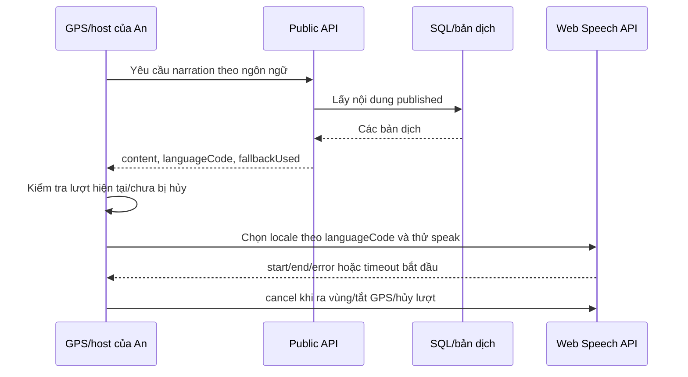

# Bảo — nội dung, ngôn ngữ và giọng đọc

Nguồn code: main `a39128650e5e780dc4a2fded45a74b81a50f1c1e`. Phạm vi theo kế hoạch cập nhật 02/11/2026; tiếp nhận quản lý không thay đổi tác giả lịch sử.

## File bàn giao

| File | Vai trò |
| --- | --- |
| [BaselineContent.json](../../src/Vivoice.Web/Data/BaselineContent.json) | 11 POI TP.HCM, 33 chủ đề; tên, mô tả, narration và sourceUrls |
| [BaselineContent.cs](../../src/Vivoice.Web/Data/BaselineContent.cs) | Loader JSON và danh sách vi/ko/ja/zh/en |
| [tts-language.js](../../src/Vivoice.Web/wwwroot/tts-language.js) | Chuẩn hóa mã, ánh xạ locale, chọn giọng |
| [BaselineContentTests.cs](../../tests/Vivoice.Web.Tests/Unit/BaselineContentTests.cs) | Kiểm tra hợp đồng catalog bằng C# |
| [tts-language.test.cjs](../../tests/Vivoice.Web.Tests/Frontend/tts-language.test.cjs) | Kiểm tra ánh xạ/fallback chọn giọng |

Các file trên giữ nguyên từ main. [Tham chiếu dùng chung](SHARED_CODE_REFERENCE.md) trích nguyên phần giọng đọc trong public.js và fallback trong PublicContentService.cs, không mang toàn bộ module của An/Tài vào nhánh.

## Tích hợp

Đây là gói bàn giao, không phải website độc lập. Tích hợp năm file vào ứng dụng đầy đủ, giữ nguyên đường dẫn. Project host cần nhúng Data/BaselineContent.json với resource name `Vivoice.Web.Data.BaselineContent.json` như project trên main. DbContext, seed, API, DTO, GPS, DOM public và launcher do host cung cấp; không thuộc gói này. Không merge việc xóa các module khác của nhánh bàn giao vào main; chỉ lấy năm file nêu trên. Những file này đã có trên main nên không cần áp lại nếu không có thay đổi mới.

## Cơ chế và giới hạn

Nội dung là bản dịch lưu sẵn, không phải gọi dịch máy. Web Speech API đọc văn bản trên thiết bị, không tạo MP3 trên server. Locale lấy từ ngôn ngữ narration thực tế; fallback nội dung và fallback giọng là hai việc khác nhau. Không có giọng khớp thì không gán voice để trình duyệt thử mặc định; điều đó không bảo đảm đọc đúng ngôn ngữ hoặc phát thành công.

## Sequence hiện hành

GPS mới là kích hoạt tự đọc; chọn POI/chủ đề thủ công chỉ xem trước theo main hiện hành. Ranh giới này thuộc hợp đồng phối hợp với An.

## Kiểm chứng

Xem [E1 nội dung/ngôn ngữ](E1_CONTENT_REVIEW.md) và [E3 giọng đọc](E3_VOICE_MATRIX.md). Tài liệu sequence được bổ sung cho bàn giao; không phải bằng chứng thử GPS/âm thanh thực tế.
